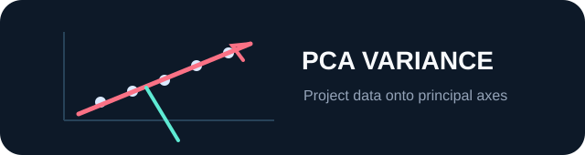

<div align="center">


[](LICENSE)

[](https://github.com/CyberLoop-dev/pca-variance-explorer/stargazers)




</div>

## 🧭 Overview
A local, dependency-free 2D Principal Component Analysis explorer. Paste coordinate pairs to calculate the covariance matrix, eigenvalues, principal directions, explained variance, and projected coordinates.

## ✨ Features
- 📊 Parses a small two-column dataset from text.
- 🧮 Computes the 2×2 covariance matrix and analytic eigenpairs.
- 🧭 Draws PC1 and PC2 directions over the scatter plot.
- 📉 Reports explained variance and projected coordinates.
- 🔒 Processes data in the browser without an API.

## 🖥️ Demo
Run the local Node.js server; no hosted demo is configured.

## 🚀 Quick Start
```bash
npm start
```
Open `http://127.0.0.1:4177`. Run calculation tests with `npm test`.

## 🧰 Tech Stack
- Node.js built-in HTTP server
- Vanilla JavaScript ES modules
- HTML Canvas
- Node.js built-in test runner

## 🗂️ Folder Structure
```text
.
├── assets/mark.svg
├── public/app.js
├── public/index.html
├── public/pca.js
├── public/styles.css
├── tests/pca.test.js
├── package.json
└── server.js
```

## 🗺️ Roadmap
- [ ] Add optional standardization (z-score scaling).
- [ ] Add a covariance-matrix heatmap.
- [ ] Support CSV upload with a selected pair of columns.

## 🤝 Contributing
Include a reproducible point set and expected numerical behavior for algorithm changes. Keep all calculations local.

## 📄 License
MIT. See [LICENSE](LICENSE).

<div align="center">


</div>
